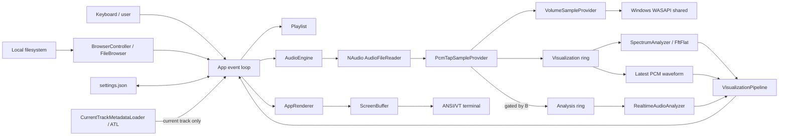
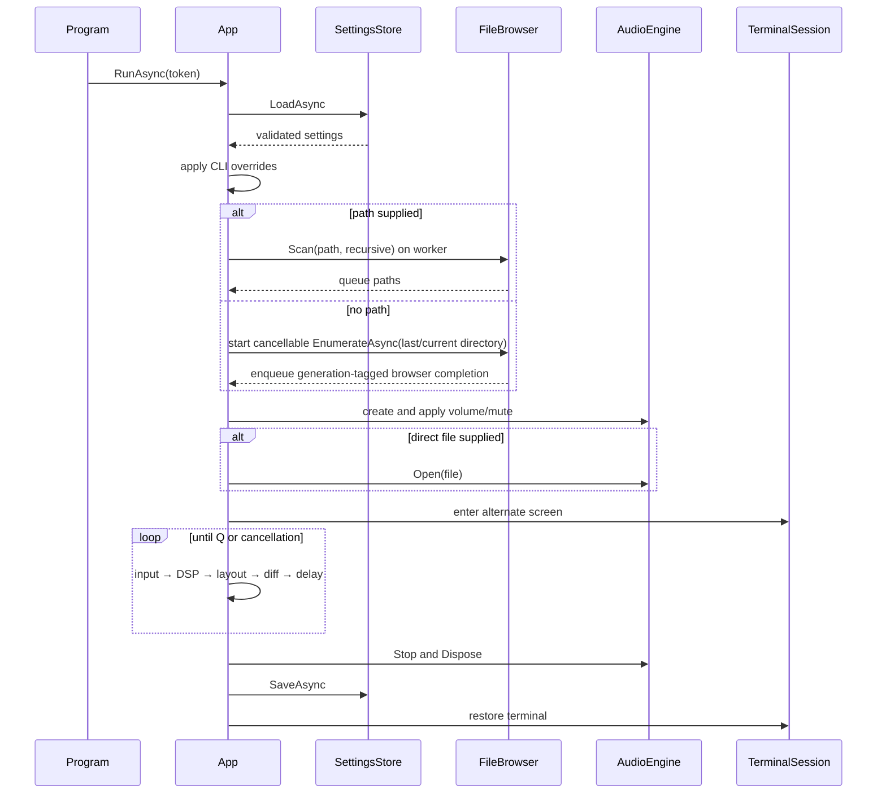
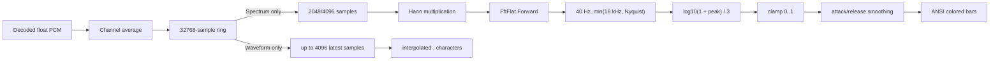

# Yacplayer Architecture

**Language:** English · [Русский](ARCHITECTURE.ru.md) · [README](../README.md)

## 1. Purpose and scope

This document describes the architecture that is actually implemented in Yacplayer 1.26.5.11: components, data flow, execution contexts, state, resource ownership, build/release flow, known limitations, and extension points. It is not an aspirational feature list; gaps between the implementation and the intended design are listed explicitly under “Limitations and technical debt.”

The target is Windows x64, `.NET 10`, and `net10.0-windows`. The application ships as one managed executable with framework-dependent DLLs and an optional Inno Setup installer.

## 2. Architectural principles

1. **One process and one shipping project.** There are no services, IPC endpoints, databases, or plugin hosts.
2. **Audio is isolated from presentation work.** NAudio/WASAPI requests decoded PCM; FFT, metadata, JSON, and terminal rendering do not execute in the audio callback.
3. **Bounded sample transport.** The PCM tap writes to fixed-size visualization and optional analysis rings. Under overload, stale samples are discarded instead of blocking playback.
4. **UI-owned application state with explicit coordinators.** `App` owns the event loop and command routing; `BrowserController`, `CurrentTrackMetadataLoader`, `VisualizationPipeline`, and `SettingsController` own their respective mutable lifecycles, while `AppRenderer` owns layout only.
5. **Device-independent domain tests.** Playlist, ring, FFT, settings, browser filtering, and terminal diff logic can run without WASAPI hardware.
6. **Declarative terminal frames.** A complete `ScreenBuffer` is built first and compared with the preceding frame to produce an ANSI diff.
7. **Deterministic terminal restoration.** `TerminalSession.Dispose` restores colors, the cursor, and the primary screen; Ctrl+C becomes cooperative cancellation.

## 3. System context



### Runtime dependencies

| Package | Version | Responsibility |
|---|---:|---|
| `NAudio` | 3.3.0 | Meta-package and `AudioFileReader` |
| `NAudio.Core` | 3.3.0 | Wave/sample abstractions and core readers/providers |
| `NAudio.Wasapi` | 3.3.0 | `WasapiPlayer` and Media Foundation integration |
| `FftFlat` | 1.0.1 | Complex FFT implementation |
| `z440.atl.core` | 7.19.0 | Read-only media metadata extraction |

xUnit, Microsoft.NET.Test.Sdk, coverlet, and the VS xUnit runner are test-only dependencies.

## 4. Source organization

| Path | Responsibility |
|---|---|
| `Program.cs` | Process entry, UTF-8, CLI boundary, exit codes, Ctrl+C, top-level exception handling |
| `App.cs` | Composition root, event loop, command routing, and shutdown/settings orchestration |
| `Application/BrowserController.cs` | Browser navigation/load lifecycle, path deduplication, and batch queue insertion |
| `Application/CurrentTrackMetadataLoader.cs` | Cancellation and completion ownership for current-track metadata |
| `Application/VisualizationPipeline.cs` | Spectrum/waveform/realtime-analysis coordination and reset rules |
| `Application/SettingsController.cs` | Full-screen settings navigation, value changes, and path validation |
| `Presentation/AppRenderer.cs` | Player/browser/settings layouts, viewports, and `ScreenBuffer` composition |
| `Presentation/ReactiveThemeController.cs` | Feature smoothing and bounded HSL color derivation for the music-reactive UI |
| `Cli/Arguments.cs` | Deterministic command-line parser and help text |
| `Configuration/` | Persisted settings and atomic JSON storage |
| `Library/Playlist.cs` | Queue selection, navigation, repeat, shuffle bag/history |
| `Library/FileBrowser.cs` | Enumeration, filtering, sorting, and recursive scanning |
| `Library/TrackEntry.cs` | Queue and metadata model |
| `Library/MetadataService.cs` | Background ATL loader for the current track |
| `Audio/AudioEngine.cs` | Decoder/output lifecycle and playback commands |
| `Audio/PcmTapSampleProvider.cs` | PCM forwarding plus mono visualization and gated analysis taps |
| `Audio/SampleRingBuffer.cs` | Bounded transport between audio and DSP |
| `Audio/PlaybackSnapshot.cs` | Immutable UI-facing playback state |
| `Dsp/SpectrumAnalyzer.cs` | Hann window, FFT, logarithmic bands, normalization |
| `Dsp/RealtimeAudioAnalyzer.cs` | Levels, zero-crossing, spectral features, beat pulse, and heuristic tempo |
| `Terminal/TerminalSession.cs` | Alternate-screen lifetime management |
| `Terminal/ScreenBuffer.cs` | Styled cells, clipping, sanitization, ANSI diff batching |
| `tests/Yacplayer.Tests/` | Device-independent unit tests |
| `installer/Yacplayer.iss` | Per-user x64 installer definition |

## 5. Process lifecycle

### 5.1 Entry point

`Program.cs` performs the following sequence:

1. Configures stdin/stdout for UTF-8.
2. Parses arguments with `Arguments.Parse`.
3. Prints malformed-CLI errors and returns exit code `2`.
4. Handles `--help` and `--version` without constructing `App`, audio, or an alternate screen.
5. Rejects a missing positional path with exit code `3`.
6. Creates a `CancellationTokenSource`; `Console.CancelKeyPress` cancels it and suppresses immediate process termination.
7. Runs `App.RunAsync`.
8. Maps an unhandled startup/runtime exception to stderr and exit code `3`.

### 5.2 Startup and shutdown sequence



`App.RunAsync` owns `AudioEngine` and `TerminalSession` through deterministic `using` scopes. `Q` first opens a modal `Yep` / `Nope` confirmation with `Nope` selected by default; a confirmed exit and cancellation pass through the same cleanup path. Saving errors do not prevent exit.

## 6. Application event loop

`App` is the composition root and command/event-loop coordinator; no DI container is used. It creates the audio engine and the following focused components:

- `BrowserController` owns browser navigation, cancellable generation-tagged loads, deduplication, and queue batches;
- `CurrentTrackMetadataLoader` owns the current-track cancellation/completion lifecycle;
- `VisualizationPipeline` owns both sample rings, visualizer smoothing, waveform reads, and realtime-analysis resets;
- `SettingsController` owns full-screen settings selection and path-edit state and returns explicit change effects to `App`;
- `AppRenderer` owns list viewports and all player/browser/settings layout composition, but does not issue playback, filesystem, or settings commands.

Each frame:

1. Lets the audio/browser/metadata coordinators drain generation-checked completions into UI-owned state.
2. Processes all currently available keys with `Console.KeyAvailable`.
3. Reads terminal width and height inside an exception boundary.
4. Obtains a `PlaybackSnapshot`;
5. asks `VisualizationPipeline` to run only the active visualizer and enabled realtime-analysis paths and apply reset rules;
6. packages the current references/snapshots into `AppRenderState`;
7. asks `AppRenderer` to create a `ScreenBuffer` and build the settings, browser, or player layout;
8. diffs the frame against the previous one and writes ANSI output;
9. waits `1000 / FPS` milliseconds with cancellation.

The loop does not busy-spin. The requested FPS is an upper bound because frame work is added before the fixed delay.

## 7. Command-line boundary

`Arguments.Parse` is a single-pass parser with no third-party CLI package. It permits one positional path and flags in any order.

Invariants:

- `--fps` accepts only `30` or `60`;
- a second positional path is rejected;
- an unknown token beginning with `-` is rejected;
- the positional path is normalized with `Path.GetFullPath`;
- parsing does not touch audio or the terminal;
- path existence is checked later by `Program`.

## 8. Playlist state machine

`Playlist` owns `_items`, nullable `CurrentIndex`, `SelectedIndex`, a shuffle `_bag`, navigation `_history`, and repeat/shuffle flags.

### Sequential mode

- `Next()` starts at index `0` when no item is current.
- `RepeatMode.All` wraps the final item to index `0`.
- `Off` ends the queue at the final item.
- automatic EOF with `RepeatMode.One` selects the current item again.
- manual next still traverses the queue in repeat-one mode because the special case applies only to `automatic=true`.

### Shuffle

`RefillBag` stores every index except the current one. `PopBag` randomly chooses and removes an index, preventing repeats within the current cycle. `Add`/`AddRange` append only newly inserted indices while shuffle is active, preserving already-consumed entries instead of rebuilding the cycle. `All` creates a new cycle after exhaustion; when a one-track playlist leaves the refilled bag empty, the current item is replayed directly instead of popping the bag. `Off` ends the cycle.

### History and removal

`Play` pushes the previous index onto history. `Previous` first consumes history, then falls back to `index - 1`. Removal clears history, rebuilds the bag, and chooses the same index or the final remaining element when the current item is removed. No filesystem deletion API is called.

### Duplicate policy

The playlist itself permits duplicates. `App` maintains a case-insensitive `HashSet` of queued paths for browser operations, so repeated activation and directory batches reject duplicates in average constant time per path. The set is synchronized when browser additions or queue removals change the playlist.

## 9. Filesystem and browser

### Enumeration

`FileBrowser.EnumerateAsync` runs cancellable enumeration inside `Task.Run`, uses the attributes supplied by `FileSystemInfo` enumeration instead of a separate `Directory.Exists` probe per entry, retains directories and allowlisted extensions, sorts directories first, then sorts names case-insensitively.

Allowlist: `.wav`, `.mp3`, `.m4a`, `.aac`, `.wma`, `.flac`.

`IOException` and `UnauthorizedAccessException` become an empty result. The current UI cannot distinguish an inaccessible directory from a legitimately empty one.

### Navigation

`BrowserController` stores path, entries, selected index, queued-path deduplication, and the virtual-drive-level flag. Starting navigation cancels the previous load, clears the old entries, and returns immediately to the frame loop. The worker posts a generation-tagged completion; `App` asks the controller to drain it on the UI loop, where stale generations are ignored. Index `0` is reserved for `[..]` in normal directories and `[This PC]` at the virtual root. `Backspace` and `Enter` on `[..]` share the same parent transition. Above a drive root, ready drives from `DriveInfo.GetDrives()` are displayed.

`AppRenderer` owns independent `ListViewport` instances for the file list, main queue, and browser-side queue. Each keeps a target index visible with a one-row margin, clamps its offset after collection/window-size changes, and never reorders the underlying collection. The main queue follows `SelectedIndex` (which playback also synchronizes to `CurrentIndex`); the browser-side informational queue follows `CurrentIndex` when available.

### Recursive scan

`FileBrowser.Scan` uses an explicit stack. Non-recursive mode visits only the selected directory. Recursive mode pushes child directories while skipping `FileAttributes.ReparsePoint`, preventing common junction and symlink loops. An inaccessible branch is skipped while other branches continue.

## 10. Audio subsystem

### Ownership and source chain

`AudioEngine` owns one `AudioFileReader` and one `WasapiPlayer`. `Open` calls `Close` first, so at most one decoder/output pair is active.

```text
AudioFileReader (ISampleProvider)
  → PcmTapSampleProvider
  → VolumeSampleProvider
  → ToWaveProvider()
  → WasapiPlayer.Init
  → default Windows render endpoint
```

The player is built in shared mode with a requested latency of 100 ms.

### Commands

- `Open(path)` creates decoder, tap, output, initializes, and starts playback;
- `TogglePause()` maps playing/paused to pause/play;
- `Stop()` marks an intentional stop, stops output, resets position and the ring;
- `Seek(seconds)` clamps to the track duration and resets the ring;
- `SetVolume` clamps to 0–100 and updates the post-tap `VolumeSampleProvider`;
- `ToggleMute` preserves logical volume while applying effective volume zero;
- `Dispose` unsubscribes, stops/disposes output, and disposes the reader.

### EOF and errors

`PlaybackStopped` performs no playlist or UI mutation. It nonblockingly publishes a bounded `AudioEvent` tagged with the decoder/output generation. Intentional stop/close suppresses EOF and invalidates the generation. The UI loop drains the queue, ignores stale generations, presents errors, and selects the next automatic playlist entry or displays `Queue finished` after natural completion.

### Snapshot boundary

The UI does not receive decoder/output objects. `PlaybackSnapshot` exposes state, path, position, duration, sample rate, channels, logical volume, and mute.

## 11. PCM tap and ring buffer

`PcmTapSampleProvider` forwards decoded samples while also copying mono data to the visualization ring and, only while enabled, a separate analysis ring. `VolumeSampleProvider` follows the tap, so output volume and mute affect WASAPI playback but do not alter visualization or analysis. Mono input is written in one block; multichannel frames are averaged across channels.

The tap does not perform FFT, tempo estimation, logging, JSON, metadata, or terminal I/O. `AudioEngine.SetRealtimeAnalysis(false)` gates the secondary ring write and resets its transport generation; `App` then stops invoking `RealtimeAudioAnalyzer` as well as hiding its panel. `AudioEngine.SetReactiveAnalysis(true)` additionally keeps the analysis ring fed (`PcmTapSampleProvider.AnalysisAlways`) while the realtime panel is off, because the music-reactive UI consumes the same features; the expensive UI-side analyzer call remains gated on panel-or-theme need.

`SampleRingBuffer` owns a fixed `float[]` (rounded up to a power of two) and monotonically increasing read/write counters with bitmask addressing. The producer owns only `_write`; the consumer owns `_read` and, on overflow, catches itself up to `write - capacity` before copying so the oldest samples are dropped without the producer ever writing the read cursor. `Reset` moves read to the current write position after stop, seek, track change, or visualizer-mode change. `ReadLatest` copies the newest block and discards older backlog for the waveform.

`RealtimeAudioAnalyzer` runs on the UI loop. It derives RMS and peak dBFS, crest factor, zero-crossing rate, spectral centroid, dominant frequency, and a normalized low-band (40–150 Hz) bass-energy feature from bounded windows. Tempo analysis uses a 1024-sample Hann STFT with a 256-sample hop. Positive log-magnitude changes are averaged into low, mid, and high bands and normalized against an adaptive flux baseline to form the onset envelope.

`BeatTracker` retains a bounded onset history. Normalized autocorrelation searches 55–200 BPM, parabolic peak interpolation removes integer-hop quantization, and phase scoring penalizes hypotheses that predict unsupported beats or explain too little onset energy. Up to eight tempo/phase agents are retained. Salient onsets update every agent through a proportional/integral phase-locked loop; evidence decay, confidence, continuity bias, and switching hysteresis select the active agent. The displayed beat is generated from its predicted phase, so it can continue through a short missing-beat section instead of merely echoing an energy transient. A broad prior prefers common metrical levels around 120 BPM while retaining candidates across the full range.

The result remains a causal realtime estimate rather than embedded BPM metadata or an offline whole-track analysis. It needs several seconds to lock, deliberately trades responsiveness for stability, and can still choose a different metrical level for syncopated, changing, or ambiguous material.

The concurrency model is one producer (the audio callback, owning `_write`) and one consumer (the UI loop, owning `_read`). The overflow catch-up runs entirely on the consumer side, so neither cursor is ever written by both threads; this replaced the earlier protocol where producer overflow also advanced `_read`, which could rewind the consumer under a check-then-act interleaving. Concurrent producer/consumer regression tests cover overflow, `ReadLatest`/`Reset` interleavings, and the stale-cursor clamp.

## 12. DSP pipeline



`SpectrumAnalyzer` allocates FFT buffers, the transform, and the Hann window once. Each analysis uses an exact-window ring read: if fewer than the configured FFT samples are available, nothing is consumed and the previous bands remain intact. A complete block is windowed, transformed with a complex forward FFT, mapped to logarithmic frequency bands by peak magnitude, and normalized to 0–1.

The UI uses 64 bands and interpolates them to the spectrum-panel width. Vertical levels use ANSI true color with a continuous green-to-yellow-to-red gradient; a yellow marker is drawn at the current bar height. The marker is not a time-based peak-hold buffer.

Waveform mode reads up to 4096 newest mono PCM samples and applies per-frame visual gain so the shape remains visible at low playback volume without changing audio. Each terminal column receives the minimum/maximum envelope of its sample range, mapped around the vertical center and drawn with green `.` characters. Near-silence is left blank instead of amplifying noise. Off mode performs neither FFT nor waveform sampling. The panel title and detail label follow the selected mode.

Current caveat: the last valid spectrum is retained without elapsed-time decay when playback is inactive or samples stop arriving.

## 13. Terminal rendering

### Terminal session

Interactive construction enters the alternate screen, disables automatic line wrapping, hides the cursor, and clears the screen. Disposal resets SGR, restores line wrapping and the cursor, and returns to the primary screen. Redirected stdout produces no terminal-control output.

### Cell model

A `Cell` stores one UTF-16 `char`, foreground, background, and bold state. `ScreenBuffer.Write` clips coordinates and replaces ESC/control characters with spaces, preventing current metadata/path text from injecting raw ANSI sequences.

One `char` is still assumed to occupy one terminal column. Grapheme clusters, surrogate pairs, and East Asian wide-character widths are not measured separately; writes containing likely wide/zero-width Unicode mark their row for conservative repainting.

### Differential rendering

`Diff(previous)` skips equal cells and combines adjacent changed cells with identical style into horizontal runs. Each run receives one cursor-position escape and only necessary SGR changes. A row containing likely variable-width Unicode in either the current or previous frame is erased and repainted completely to remove orphaned terminal glyphs. Resizing changes buffer dimensions and forces a full redraw.

Current caveat: a new `ScreenBuffer`, cell array, `StringBuilder`, and ANSI string are created for every frame. Reusable double buffers and pooled output are the main GC optimization opportunity.

### Responsive layouts

- Player mode always has header and footer.
- At `width >= 90` and `height >= 22`, it draws Now Playing, Queue, Spectrum, Playback, and Audio Info panels.
- Smaller terminals use compact Now Playing and Spectrum panels.
- Browser width ≥70 shows files and queue; narrower terminals show files only.

### Music-reactive UI theme

`ReactiveThemeController` (UI loop only) converts smoothed music features into a bounded color scheme for panel borders, green panel-title backgrounds, the active queue-row background, the footer, and the spectrum bars (the reactive gradient keeps the static ramp's green-to-warm shape rotated to the theme hue and brightened by the bass pulse; the bar-top marker follows the theme instead of static yellow). Bass energy drives a brightness pulse (single-pole attack ≈ 70 ms, release 350–450 ms, bounded to roughly the 10–20% luminance range), spectral centroid maps logarithmically to a limited green-teal hue band (not the full wheel) with a 2–3 s time constant, and RMS modulates saturation around the static green. Updates are gated to about 12.5 FPS independent of the UI/FFT rate. When `ReactiveUiMode` is `Off` (the default) the controller no-ops and the renderer keeps its static ANSI theme; when playback is not playing or features are unavailable, parameters glide back to the base theme through the release path rather than snapping. Colors are emitted as RGB true-color SGR sequences (the spectrum already requires true color); terminals without true-color support see the same sequences and may downgrade them, which matches the existing spectrum behavior. No geometry, layout, informational text, or semantically meaningful colors change.

## 14. Input routing

Input routing is contextual:

1. The exit-confirmation dialog consumes arrows/Tab, Enter, Esc, Y, and N. It is available over the player, browser, help, and settings, except while a settings path is being edited.
2. Help overlay consumes close keys and suppresses normal commands.
3. Browser mode routes keys to browser commands.
4. Otherwise, the player keymap is active.

`Console.KeyAvailable` avoids blocking frame rendering. Keyboard text is never forwarded to a shell or interpreted as ANSI output.

## 15. Settings persistence

`PlayerSettings` is a version-1 mutable JSON model.

Validation:

- volume is clamped to 0–100;
- FPS is 30 or 60, otherwise 30;
- FFT size is 2048 or 4096, otherwise 2048;
- unknown enum values become defaults;
- unavailable last or startup directories are cleared.

`SettingsStore.LoadAsync` returns defaults for a missing file or IO failure. Malformed JSON is moved to `.bad` when possible. `SaveAsync` creates the parent directory, writes `.tmp`, then moves it over the destination.

CLI FPS, recursive, and no-visualizer flags override the in-memory model. Loaded repeat/shuffle values are applied to `Playlist` during startup. `RealtimeAnalysisEnabled` controls the persisted `B` toggle and defaults to true. With no CLI path, startup resolves `StartupDirectory`, then `LastDirectory`, then the process working directory.

`O` opens the full-screen settings view. Every successful edit is applied on the UI loop and immediately passed to `SettingsStore.SaveAsync`; volume/mute, FPS, FFT size, visualizer, realtime analysis, repeat, shuffle, and recursive scanning affect the running process. Changing `LastDirectory` starts an asynchronous browser load, while `StartupDirectory` controls the next pathless launch. The settings schema version is displayed read-only. Shutdown still captures and saves runtime volume, mute, repeat, and shuffle state.

## 16. Metadata

`TrackEntry` contains path, title, artist, album, duration, and metadata state. Defaults are filename title and `Unknown artist`.

`MetadataService.LoadAsync` constructs an `ATL.Track` on a worker task and returns title/artist/album/duration with fallbacks. Original media files are never modified.

`App` starts a load only for the current playlist entry. Changing tracks cancels the previous request and stale completions are ignored. The worker never mutates `TrackEntry`: it places a completion in a concurrent queue, and the UI loop applies the result and changes `MetadataState` to `Loaded` or `Failed`. Entries that have not become current retain their filename/`Unknown artist` defaults.

## 17. Error boundaries

| Boundary | Behavior |
|---|---|
| CLI parse | stderr and exit 2 |
| Missing startup path | stderr and exit 3 |
| Decoder/output open | bounded `AudioEventKind.Error`, UI status update, application continues |
| Playback failure | bounded, generation-tagged `AudioEventKind.Error` |
| Browser IO/access | empty list, UI remains active |
| Recursive branch failure | branch is skipped |
| Malformed settings | rename to `.bad`, use defaults |
| Settings IO | defaults on load or ignored save failure |
| Terminal-size exception | event loop exits and session restores terminal |
| Ctrl+C | cancellation and normal cleanup |
| Other top-level failure | stderr and exit 3 |

## 18. Threading model

- Main async context: input, playlist/browser state, DSP, layout, and settings orchestration.
- NAudio playback thread: provider reads, mono downmix, always-on visualization writes, and conditionally enabled analysis-ring writes.
- Thread pool: directory enumeration/scanning and isolated metadata loads.
- NAudio event context: `PlaybackStopped` only attempts a bounded channel write.

No unbounded thread creation is present. The ring, bounded audio-event channel, and browser/metadata completion queues are the explicit cross-context boundaries. Playlist, browser, and audio transitions occur on the UI loop; workers publish generation-checked results and NAudio callbacks never block waiting for the consumer.

## 19. Resource and performance characteristics

- PCM ring: 32,768 mono floats, approximately 128 KiB.
- Realtime-analysis ring: 65,536 mono floats, approximately 256 KiB; writes and consumer DSP are disabled by `B`.
- Requested WASAPI latency: 100 ms.
- UI FPS: 30 default, 60 optional.
- FFT: 2048 default; settings also accept 4096.
- FFT buffers and Hann window are reused.
- A fresh screen cell array and ANSI output are allocated each frame.
- Diff rendering reduces terminal traffic by batching styled runs.
- DSP overload discards stale ring data rather than blocking audio.
- Directory enumeration runs off the UI thread, although startup scan completes before the TUI opens.

The project makes no unmeasured CPU or RAM claims. Recommended profilers are `dotnet-counters`, `dotnet-trace`, and Windows Performance Recorder.

## 20. Tests

The automated suite does not create a real WASAPI device.

Covered:

- invalid CLI flags/FPS, help parsing, and the four-part assembly release version;
- empty/basic playlist, repeat, removal, and shuffle-cycle uniqueness;
- ring wrap/overwrite/count;
- identical terminal frames, one-cell/color changes, and ANSI batching;
- settings validation, round trip, and malformed JSON;
- silence and synthetic 1 kHz FFT input;
- gated pre-volume analysis tapping and synthetic level/frequency/tempo input;
- nonfatal metadata fallback;
- browser directory-first sorting and extension filtering.

Not covered automatically:

- real WAV/MP3 hardware playback;
- WASAPI pause/seek/mute timing;
- natural EOF races and rapid track switching;
- input routing and layout snapshots;
- installer execution/uninstall;
- long-running memory/soak behavior;
- a comprehensive concurrent ring stress test.

## 21. Build, publish, and installer

```text
Yacplayer.sln
├─ src/Yacplayer/Yacplayer.csproj       net10.0-windows executable
└─ tests/Yacplayer.Tests/...csproj      xUnit project referencing the app
```

`ApplicationIcon` points to `assets/Yacplayer.ico`, which contains PNG-backed 16, 24, 32, 48, 64, 128, and 256-pixel layers.

Framework-dependent publish:

```powershell
dotnet publish src/Yacplayer/Yacplayer.csproj -c Release -r win-x64 --self-contained false -o artifacts/publish
```

Native AOT publish:

```powershell
dotnet publish src/Yacplayer/Yacplayer.csproj -p:PublishProfile=NativeAotWinX64
```

The `NativeAotWinX64` profile produces a trimmed, self-contained native executable in `artifacts/publish-aot`. Settings JSON uses source-generated `System.Text.Json` metadata, so persistence does not depend on runtime code generation. This profile changes deployment and startup characteristics only; it does not remove the Windows/WASAPI platform boundary.

Inno Setup performs a per-user installation into `{localappdata}\Programs\Yacplayer`, targets x64-compatible Windows 10 build 17763+, offers English and Russian wizard languages, installs Start-menu and optional desktop shortcuts, checks for `.NETCore.App\10.*`, includes both documentation languages and notices, excludes PDB files, and writes the setup to `artifacts/installer`.

The shortcut working directory is `{userdocs}` so a first browser launch does not begin inside the installation directory.

## 22. Security and privacy

- Runtime telemetry and network requests are absent.
- Selected local media and settings are read; media files are never modified.
- Browser `Delete` is not mapped to filesystem deletion.
- Control characters are sanitized before terminal cells are written.
- Recursive scanning skips directory reparse points.
- External decoder executables are not launched.
- The installer opens the official .NET download page only after consent when runtime is missing.
- Yacplayer is not a security sandbox: third-party decoder and metadata libraries parse media in-process.

## 23. Limitations and technical debt

Priority gaps:

1. Distinguish inaccessible directories from empty directories.
2. Add grapheme/display-width-aware text layout.
3. Replace the ring with a clearly proven SPSC implementation and add sustained concurrency tests.
4. Add generated-WAV integration, optional WASAPI smoke, and terminal snapshot tests.
5. Consider a self-contained installer or runtime bootstrapper.
6. Reuse two screen buffers and pooled ANSI output to reduce per-frame GC pressure.
7. Add time-based spectrum decay and skip spectrum analysis while playback is inactive.
8. Batch multichannel downmix/ring writes and make recursive scans incremental and cancellable.

## 24. Extension points

### New decoder or format

Adding an extension to the browser allowlist does not add a decoder. Confirm that `AudioFileReader`/Media Foundation opens the format, update the format matrix and error messages, and add integration coverage.

### New visualization mode

Introduce a dedicated DSP snapshot/model and renderer. Analysis must remain outside `PcmTapSampleProvider.Read`; a worker/UI consumer should read bounded data.

### New terminal widget

Write only through `ScreenBuffer`, respect clipping, and never embed raw escape sequences. ANSI policy remains inside `ScreenBuffer.Diff` and `TerminalSession`.

### New persisted setting

Add a default, validation/migration logic, document the JSON field, and preserve compatibility with settings `Version`.

### New background operation

Provide cancellation, bounded concurrency, and observed errors. Apply results to UI-owned state through an event/command boundary.

## 25. Architectural invariants

- At most one active reader/output pair exists.
- The audio callback performs no FFT, terminal rendering, metadata, or JSON I/O.
- Sample transport is bounded and never waits for the visualizer.
- Queue removal never deletes a physical file.
- Help/version create neither audio nor the alternate screen.
- User-controlled text cannot become a raw ANSI escape sequence through the cell writer.
- Terminal restoration is deterministic under normal shutdown and Ctrl+C.
- Recursive scan does not follow directory reparse points.
- Runtime uses neither network services nor external decoder executables.
