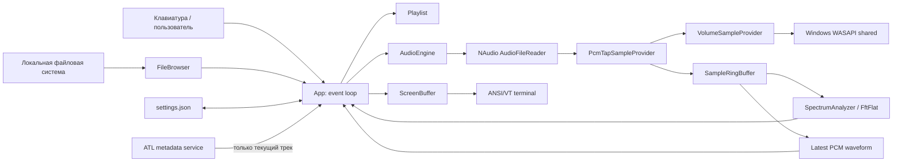
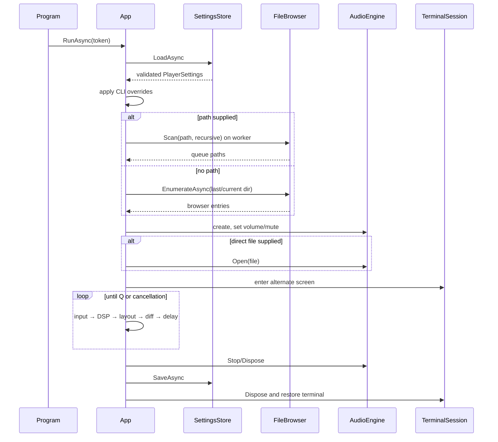
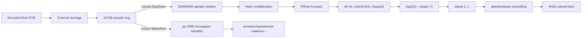

# Архитектура Yacplayer

**Язык:** Русский · [English](ARCHITECTURE.md) · [README](../README.ru.md)

## 1. Назначение документа

Документ описывает фактически реализованную архитектуру Yacplayer 1.26.3.11 на уровне компонентов, данных, потоков исполнения, состояний, resource ownership и build/release pipeline. Он не является списком желаемых функций: отличия текущей реализации от целевой модели перечислены в разделе «Ограничения и технический долг».

Целевая платформа приложения — Windows x64, `.NET 10`, `net10.0-windows`. Shipping unit — один managed executable с framework-dependent DLL-зависимостями и опциональным Inno Setup installer.

## 2. Архитектурные принципы

1. **Один процесс, один shipping project.** Нет сервисов, IPC, базы данных и plugin host.
2. **Audio path отделён от UI.** Декодирование и выдача PCM инициируются NAudio/WASAPI; FFT и ANSI-rendering не выполняются внутри audio callback.
3. **Bounded data flow.** PCM tap пишет в кольцевой буфер фиксированного размера. При перегрузке старые samples вытесняются, а воспроизведение не ждёт визуализатор.
4. **UI управляет состоянием.** `App` содержит event loop, keyboard dispatch, browser state, playlist orchestration, DSP sampling и layout.
5. **Доменная логика тестируема без устройства.** Playlist, ring buffer, FFT, settings, browser filtering и terminal diff не требуют WASAPI.
6. **Terminal output строится декларативно.** Каждый кадр сначала формируется в `ScreenBuffer`, затем сравнивается с предыдущим и превращается в минимизированный ANSI diff.
7. **Ошибки окружения не должны повреждать терминал.** `TerminalSession.Dispose` восстанавливает экран, цвета и курсор; Ctrl+C переводится в cancellation.

## 3. Контекст и зависимости



Runtime NuGet dependencies:

| Пакет | Версия | Роль |
|---|---:|---|
| `NAudio` | 3.3.0 | Meta-package и `AudioFileReader` |
| `NAudio.Core` | 3.3.0 | Wave/sample abstractions, readers/providers |
| `NAudio.Wasapi` | 3.3.0 | `WasapiPlayer`, Media Foundation integration |
| `FftFlat` | 1.0.1 | Complex FFT |
| `z440.atl.core` | 7.19.0 | Read-only metadata extraction |

Test-only dependencies: xUnit, Microsoft.NET.Test.Sdk, coverlet collector, xUnit VS runner.

## 4. Структура исходников

| Путь | Ответственность |
|---|---|
| `Program.cs` | Process entry point, UTF-8, CLI, exit codes, Ctrl+C, global startup error boundary |
| `App.cs` | Composition root и UI/application controller |
| `Cli/Arguments.cs` | Ручной детерминированный parser CLI и статический help text |
| `Configuration/` | Persisted settings и атомарное JSON-хранилище |
| `Library/Playlist.cs` | Queue navigation, selection, repeat, shuffle bag/history |
| `Library/FileBrowser.cs` | Enumeration, filtering, sorting, recursive scan |
| `Library/TrackEntry.cs` | Queue/media metadata model |
| `Library/MetadataService.cs` | Фоновый ATL loader текущего трека |
| `Audio/AudioEngine.cs` | Decoder/output lifecycle и playback commands |
| `Audio/PcmTapSampleProvider.cs` | PCM forwarding и mono tap |
| `Audio/SampleRingBuffer.cs` | Bounded sample transport между audio и DSP |
| `Audio/PlaybackSnapshot.cs` | Immutable UI-facing playback snapshot |
| `Dsp/SpectrumAnalyzer.cs` | Hann, FFT, log bands, normalization |
| `Terminal/TerminalSession.cs` | Alternate-screen RAII |
| `Terminal/ScreenBuffer.cs` | Styled cells, clipping/sanitization, ANSI diff batching |
| `tests/Yacplayer.Tests/` | Unit tests чистой логики |
| `installer/Yacplayer.iss` | Per-user x64 installer |

## 5. Запуск и завершение процесса

### 5.1 Entry point

`Program.cs` выполняет последовательность:

1. Переключает stdin/stdout в UTF-8.
2. Вызывает `Arguments.Parse(args)`.
3. Для malformed CLI печатает ошибку и возвращает `2`.
4. Для `--help`/`--version` печатает данные и возвращает `0`, не создавая `App`, аудио и alternate screen.
5. Проверяет существование переданного пути; отсутствие возвращает `3`.
6. Создаёт `CancellationTokenSource`; обработчик `Console.CancelKeyPress` отменяет token и подавляет немедленное завершение процесса.
7. Запускает `App.RunAsync`.
8. Неперехваченная startup/runtime exception печатается в stderr и возвращает `3`.

### 5.2 Application startup



### 5.3 Shutdown ownership

- `App.RunAsync` владеет `AudioEngine` и `TerminalSession` через `using`.
- `Q` выходит через единый cleanup path.
- Ctrl+C отменяет delay/event loop; cleanup выполняется обычным control flow.
- Перед сохранением вызывается `audio.Stop()`.
- Ошибка сохранения `IOException` не мешает выходу.
- `TerminalSession.Dispose` посылает reset SGR, включает cursor и покидает alternate screen.

## 6. Application controller и event loop

`App` — текущий composition root и одновременно controller представления. Отдельного DI-container нет.

Главный цикл на каждом кадре:

1. Пока `Console.KeyAvailable`, синхронно/асинхронно обрабатывает доступные клавиши.
2. Безопасно читает `Console.WindowWidth/Height`; исключение разрывает loop.
3. Получает `PlaybackSnapshot` из `AudioEngine`.
4. Выполняет только активный путь визуализации: FFT со сглаживанием для `Spectrum`, чтение последних samples для `Waveform`, отсутствие DSP-чтения для `Off`.
5. При смене режима сбрасывает накопленные данные визуализации.
6. Создаёт новый `ScreenBuffer` текущего размера.
7. Строит browser layout либо player layout.
8. Вычисляет ANSI diff относительно прошлого кадра и пишет его в terminal.
9. Делает `Task.Delay(1000 / FPS, token)`.

Цикл не busy-spins. Фактический FPS является верхней границей: время обработки и rendering прибавляется к delay.

## 7. CLI

`Arguments.Parse` — single-pass parser без сторонней библиотеки. Он допускает один positional path и флаги в любом порядке.

Инварианты:

- `--fps` принимает только `30` или `60`;
- второй positional path — ошибка;
- неизвестный token, начинающийся с `-`, — ошибка;
- positional path нормализуется через `Path.GetFullPath`;
- parser не обращается к аудио или терминалу;
- existence check выполняется позднее в `Program`.

## 8. Playlist state machine

`Playlist` хранит:

- `_items: List<TrackEntry>`;
- `CurrentIndex: int?` — воспроизводимый элемент;
- `SelectedIndex` — выбранная UI-строка;
- `_bag: List<int>` — ещё не использованные shuffle indices;
- `_history: Stack<int>` — навигация назад;
- `Repeat` и `Shuffle`.

### 8.1 Последовательный режим

- `Next()` начинает с index `0`, если current отсутствует.
- В конце списка `RepeatMode.All` делает wrap на `0`.
- При `Off` следующий элемент в конце отсутствует.
- Автоматический EOF с `RepeatMode.One` повторно выбирает текущий index.
- Ручной next при `One` продолжает очередь, поскольку special case применяется только при `automatic=true`.

### 8.2 Shuffle

`RefillBag` заполняет bag всеми indices, кроме текущего. `PopBag` выбирает случайный элемент и удаляет его. Поэтому один index не повторяется до исчерпания bag. При `All` начинается новый цикл; при `Off` исчерпанный цикл завершает очередь.

### 8.3 Previous и removal

- Переключение track через `Play` помещает прошлый index в history.
- `Previous` сначала использует history, затем fallback на `index - 1`.
- После remove history очищается, bag перестраивается.
- Удаление current выбирает элемент на том же index, либо последний оставшийся.
- Удаляется только запись очереди; filesystem API удаления не вызывается.

### 8.4 Duplicate policy

Сам `Playlist` разрешает дубликаты. Browser UI использует `FindOrAddTrack` и case-insensitive full-path comparison, поэтому повторный `Enter` на том же файле не создаёт второй элемент. `A` также исключает уже существующие пути.

## 9. Browser и filesystem

### 9.1 Enumeration

`FileBrowser.EnumerateAsync` выполняет `Directory.EnumerateFileSystemEntries` внутри `Task.Run`, преобразует элементы в `BrowserEntry`, оставляет каталоги и allowlisted extensions, затем сортирует каталоги первыми и имена case-insensitive.

Allowlist: `.wav`, `.mp3`, `.m4a`, `.aac`, `.wma`, `.flac`.

`IOException` и `UnauthorizedAccessException` преобразуются в пустой список. В текущей модели UI не различает пустой и недоступный каталог.

### 9.2 Navigation state

`App` хранит browser path, entries, selected index, scroll offset и признак виртуального уровня дисков. Index `0` всегда зарезервирован:

- обычный каталог: `[..]`;
- виртуальный root: `[This PC]`.

`Backspace` и `Enter` на `[..]` вызывают одинаковый переход. Выше drive root строится список `DriveInfo.GetDrives().Where(IsReady)`.

### 9.3 Recursive scan

`FileBrowser.Scan` использует явный `Stack<string>`. По умолчанию сканируется только текущий каталог. В recursive mode дочерние каталоги помещаются в stack, но directories с `FileAttributes.ReparsePoint` пропускаются, что защищает от типичных junction/symlink loops.

Ошибки отдельных каталогов поглощаются, после чего scan продолжает доступные ветви.

## 10. Audio subsystem

### 10.1 Объекты и ownership

`AudioEngine` владеет одним `AudioFileReader` и одним `WasapiPlayer`. Новый `Open` сначала вызывает `Close`, то есть одновременно активен максимум один decoder/output pair.

Создание output:

```csharp
new WasapiPlayerBuilder()
    .WithSharedMode()
    .WithLatency(100)
    .Build();
```

Source chain:

```text
AudioFileReader (ISampleProvider)
  → PcmTapSampleProvider
  → VolumeSampleProvider
  → ToWaveProvider()
  → WasapiPlayer.Init
  → default Windows render endpoint
```

### 10.2 Playback commands

- `Open(path)` — decoder, tap, output init и `Play`;
- `TogglePause()` — `Pause`/`Play` по состоянию output;
- `Stop()` — intentional stop, position `0`, ring reset;
- `Seek(seconds)` — clamp в `[0, TotalTime]`, затем ring reset;
- `SetVolume(0..100)` — изменяет расположенный после tap `VolumeSampleProvider`;
- `ToggleMute()` — сохраняет logical volume, устанавливает effective volume `0`;
- `Dispose()` — отписка event, stop/dispose output, dispose reader.

### 10.3 EOF и error events

`WasapiPlayer.PlaybackStopped` обрабатывается в `OnStopped`:

- exception преобразуется в `Error` event;
- intentional stop/close подавляет EOF;
- естественный конец вызывает `Ended`.

`App` подписан на `Ended`, вызывает `Playlist.Next(automatic: true)` и открывает следующий track либо пишет `Queue finished`.

### 10.4 Snapshot boundary

UI не получает decoder/output напрямую. `PlaybackSnapshot` содержит state, path, position, duration, sample rate, channels, logical volume и mute. Snapshot строится при каждом UI frame.

## 11. PCM tap и ring buffer

`PcmTapSampleProvider` реализует `ISampleProvider` и прозрачно возвращает decoder output вызывающей стороне. `VolumeSampleProvider` расположен после tap, поэтому выходная громкость и mute влияют на WASAPI playback, но не меняют амплитуду spectrum или waveform.

- mono input копируется в ring блоком;
- multi-channel input downmix-ится средним арифметическим каналов на frame;
- tap не выполняет FFT, logging, JSON, metadata или terminal I/O.

`SampleRingBuffer` имеет фиксированный `float[]`, monotonically increasing `_write`/`_read` counters и modulo addressing.

Overflow policy: после записи writer двигает minimum read position к `write - Capacity`, то есть самые старые samples теряются. Это осознанный приоритет: устаревший spectrum отбрасывается вместо блокировки audio path.

`Reset` при stop/seek/track switch или смене режима приравнивает read position текущему write position, чтобы DSP не показал старый PCM. `ReadLatest` копирует новейший блок и отбрасывает backlog для waveform.

Текущая реализация использует `Volatile.Read/Write`, но не заявляет формально доказанную lock-free корректность для произвольного числа readers/writers. Предполагаемая модель — один producer и один consumer.

## 12. DSP pipeline



`SpectrumAnalyzer` выделяет buffers и `FastFourierTransform` один раз в constructor. Для каждого анализа:

1. Пытается прочитать ровно FFT size samples.
2. При недостатке очищает output bands и возвращает `false`.
3. Умножает samples на заранее вычисленное Hann window.
4. Выполняет complex forward FFT.
5. Для каждой output band вычисляет логарифмические low/high frequencies.
6. Находит peak magnitude в соответствующих bins.
7. Применяет `log10(1 + peak) / 3` и clamp `0..1`.

UI использует 64 output bands и интерполирует их на фактическую ширину spectrum panel. Для вертикального уровня вычисляется непрерывный ANSI true-color градиент от зелёного через жёлтый к красному; над bar рисуется жёлтый peak marker. Это визуальный marker текущей высоты, не временной peak-hold buffer.

Режим Waveform читает до 4096 новейших mono PCM samples и применяет визуальное усиление кадра, поэтому форма видна при низкой громкости без изменения звука. Для каждой колонки вычисляется min/max envelope соответствующего диапазона samples, отображается относительно вертикального центра и рисуется зелёными `.`. Почти полная тишина остаётся пустой, чтобы не усиливать шум. В режиме Off не выполняется ни FFT, ни waveform sampling. Заголовок и информационная строка панели соответствуют выбранному режиму.

## 13. Terminal subsystem

### 13.1 TerminalSession

В interactive mode constructor отправляет:

- `CSI ?1049h` — alternate screen;
- `CSI ?7l` — отключить automatic line wrapping;
- `CSI ?25l` — hide cursor;
- `CSI 2J` — clear.

Dispose отправляет SGR reset, восстанавливает automatic line wrapping, показывает cursor и покидает alternate screen. При redirected stdout session ничего не пишет.

### 13.2 Cell model

Одна `Cell` содержит:

- UTF-16 `char`;
- ANSI foreground color;
- ANSI background color;
- bold flag.

`ScreenBuffer.Write` clip-ит координаты по границам и заменяет ESC/control characters пробелом. Это не позволяет metadata/path text внедрять raw ANSI sequences через текущий char writer.

Ограничение: layout по-прежнему считает один `char` одной terminal column. Grapheme clusters, surrogate pairs и East Asian wide characters отдельно не измеряются; строки с вероятными wide/zero-width Unicode символами помечаются для консервативной перерисовки.

### 13.3 Diff algorithm

`Diff(previous)` пропускает равные cells. Изменённые соседние cells с одинаковым style объединяются в horizontal run:

1. Один cursor-position escape на run.
2. SGR отправляется только при смене fg/bg/bold.
3. Затем подряд пишутся characters run.
4. В конце цветового frame при необходимости отправляется SGR reset.

При resize размеры buffers отличаются, поэтому следующий кадр полностью перерисовывается.

Если текущая или предыдущая версия строки содержит Unicode потенциально переменной ширины, diff сначала очищает эту terminal row и затем полностью её перерисовывает. Остальные строки сохраняют обычный точечный diff.

### 13.4 Responsive layout

Player layout:

- всегда: header и footer;
- при `width >= 90 && height >= 22`: Now Playing, Queue, Spectrum, Playback, Audio Info;
- иначе: компактные Now Playing и Spectrum.

Browser layout:

- при width ≥ 70: files слева, queue справа;
- при меньшей ширине: одна files panel.

## 14. Input routing

Input имеет контекстный приоритет:

1. Если открыт help overlay, принимаются только close keys.
2. Если открыт browser, клавиши маршрутизируются в browser commands; например `Enter` не запускает selected queue item.
3. Иначе действует player keymap.

`Console.KeyAvailable` предотвращает блокировку frame rendering. Ввод не передаётся в shell и не интерпретируется как ANSI text.

## 15. Settings

`PlayerSettings` — сериализуемая mutable model с version `1`.

Validation:

- volume clamp `0..100`;
- FPS только `30` или `60`, иначе `30`;
- FFT size только `2048` или `4096`, иначе `2048`;
- неизвестные enums заменяются defaults;
- отсутствующий `LastDirectory` очищается.

`SettingsStore.LoadAsync`:

- отсутствие файла → defaults;
- valid JSON → deserialize + validate;
- `JsonException` → попытка move в `.bad` + defaults;
- `IOException` → defaults.

`SaveAsync` создаёт directory, пишет `.tmp`, затем `File.Move(tmp, target, overwrite: true)`.

CLI FPS, recursive и no-visualizer меняют in-memory settings текущего запуска. На shutdown сохраняются volume, mute, repeat, shuffle и остальная модель.

Текущий wiring gap: загруженные `RepeatMode`/`Shuffle` не передаются в `Playlist` при startup.

## 16. Metadata

`TrackEntry` содержит path, title, artist, album, duration и metadata state. Defaults берутся из имени файла/`Unknown artist`.

`MetadataService.LoadAsync` создаёт `ATL.Track` на worker task и возвращает Title/Artist/Album/Duration с fallback-значениями. Исходный файл не изменяется.

`App` запускает чтение только для текущего элемента playlist. При смене трека предыдущий запрос отменяется, а устаревший результат игнорируется. Worker не изменяет `TrackEntry`: он кладёт результат в concurrent queue, после чего UI-цикл применяет его и устанавливает `MetadataState` в `Loaded` или `Failed`. Не запускавшиеся треки сохраняют значения из имени файла/`Unknown artist`.

## 17. Error handling

| Boundary | Поведение |
|---|---|
| CLI parse | stderr + exit 2 |
| Missing startup path | stderr + exit 3 |
| Decoder/output open | `AudioEngine.Error`, status message, process продолжает работу |
| Playback exception | `Error` event |
| Browser IO/access | empty list, UI остаётся активным |
| Recursive scan branch error | branch skip |
| Bad settings JSON | rename `.bad`, defaults |
| Settings IO | defaults/load или ignored save error |
| Terminal size exception | event loop завершается и session восстанавливается |
| Ctrl+C | cancellation → normal cleanup |
| Other top-level exception | stderr + exit 3 |

## 18. Threading model

Потоки/contexts:

- main async thread: input, playlist state, browser state, DSP, layout, settings orchestration;
- NAudio playback thread: calls provider `Read`, следовательно выполняет PCM tap/ring write;
- thread pool: directory enumeration/scan и isolated metadata load;
- NAudio event context: `PlaybackStopped` и downstream `Ended` handler.

Нет unbounded thread creation. Основной shared mutable boundary — ring counters/data. Playlist/UI state предполагается main-loop owned, хотя EOF callback в текущем wiring может инициировать playlist transition из NAudio event context. Это важная точка будущего hardening: events следует помещать в UI command queue.

## 19. Performance characteristics

- PCM ring capacity: `32768` mono samples.
- WASAPI requested latency: `100 ms`.
- UI FPS: `30` default, `60` optional.
- FFT: `2048` default, `4096` accepted from settings.
- FFT buffers и Hann window переиспользуются.
- ScreenBuffer создаётся на каждый кадр; это UI-side allocation и не влияет на audio callback.
- Diff renderer уменьшает terminal traffic, объединяя styled runs.
- При DSP lag ring отбрасывает старые samples.
- Directory enumeration выполняется вне UI thread, но direct startup scan завершается до открытия TUI.

Проект не заявляет конкретные CPU/RAM показатели без профилирования. Рекомендуемые инструменты: `dotnet-counters`, `dotnet-trace`, Windows Performance Recorder.

## 20. Tests

Тесты не создают реальный WASAPI device.

Покрыто:

- CLI invalid flags/FPS/help и четырёхкомпонентная assembly release version;
- empty/basic playlist, repeat, remove;
- shuffle cycle uniqueness;
- ring wrap/overwrite/count;
- identical screen diff, one-cell change, color-only change, ANSI run batching;
- settings validate/roundtrip/bad JSON;
- silence и 1 kHz synthetic FFT signal;
- metadata fallback/nonfatal behavior;
- browser directory-first sorting и extension filtering.

Не покрыто автоматически:

- реальное WAV/MP3 playback и hardware output;
- pause/seek/mute timing на WASAPI;
- natural EOF race и rapid track switching;
- interactive input routing и layout snapshots разных размеров;
- installer execution/uninstall;
- long-running soak/memory profiling;
- concurrent ring stress после последних изменений.

## 21. Build, publish и installer

Build graph:

```text
Yacplayer.sln
├─ src/Yacplayer/Yacplayer.csproj       net10.0-windows executable
└─ tests/Yacplayer.Tests/...csproj      xUnit, references app project
```

`ApplicationIcon` ссылается на `assets/Yacplayer.ico`, содержащий PNG-backed sizes 16, 24, 32, 48, 64, 128 и 256 px.

Publish framework-dependent:

```powershell
dotnet publish src/Yacplayer/Yacplayer.csproj -c Release -r win-x64 --self-contained false -o artifacts/publish
```

Native AOT publish:

```powershell
dotnet publish src/Yacplayer/Yacplayer.csproj -p:PublishProfile=NativeAotWinX64
```

Профиль `NativeAotWinX64` создаёт trimmed self-contained нативный исполняемый файл в `artifacts/publish-aot`. JSON-настройки используют source-generated metadata `System.Text.Json`, поэтому persistence не требует генерации кода во время выполнения. Профиль меняет способ развёртывания и характеристики запуска, но не устраняет привязку к Windows/WASAPI.

Inno Setup:

- per-user install в `{localappdata}\Programs\Yacplayer`;
- x64-compatible only;
- Windows minimum `10.0.17763`;
- English/Russian wizard;
- Start menu и optional desktop shortcut;
- working directory shortcut — `{userdocs}`, чтобы first browser launch не открывался в install directory;
- проверка folder pattern `.NETCore.App\10.*`;
- bundled README, LICENSE и third-party notices;
- PDB исключён;
- output `artifacts/installer/Yacplayer-1.26.3.11-win-x64-setup.exe`.

## 22. Security и privacy

- Телеметрия и сетевые запросы в runtime отсутствуют.
- Программа читает только выбранные локальные media files/settings и не изменяет media.
- Browser Delete не привязан к filesystem deletion.
- Control characters в terminal cells заменяются пробелами.
- Reparse points не обходятся recursive scanner.
- External codec executables не запускаются.
- Installer открывает официальный .NET download URL только после явного согласия, если runtime не найден.
- Проект не является security sandbox: malformed media обрабатывается сторонними decoder/metadata libraries в процессе приложения.

## 23. Ограничения и технический долг

Приоритетные разрывы текущей архитектуры:

1. Восстанавливать repeat/shuffle из settings в `Playlist`.
2. Реализовать fullscreen visualizer для сохранённого flag либо убрать неработающий control.
3. Перенести EOF/Error events в `Channel<AudioEvent>`/command queue, чтобы playlist state менялся только UI loop.
4. Отличать inaccessible directory от legitimately empty directory.
5. Добавить queue scrolling; wide queue сейчас рисует начало списка, а не viewport вокруг selection.
6. Добавить grapheme/display-width aware text layout.
7. Перевести ring implementation на чётко доказанный SPSC algorithm и добавить длительный concurrent stress test.
8. Добавить integration WAV fixture, manual/optional WASAPI smoke test и terminal snapshot tests.
9. Рассмотреть self-contained installer или автоматический bootstrap runtime вместо блокирующей prerequisite check.
10. Разделить крупный `App` на controller/input/layout components по мере роста функций.

## 24. Точки расширения

### Новый decoder/format

Расширение в browser allowlist само по себе не добавляет decoder. Нужно подтвердить, что `AudioFileReader`/Media Foundation реально открывает формат, обновить format matrix, error messages и integration tests.

### Новый visualization mode

Нужны отдельные DSP snapshot/model и renderer path. Нельзя выполнять анализ в `PcmTapSampleProvider.Read`; worker/UI consumer должен читать bounded data.

### Новый terminal widget

Widget должен писать только через `ScreenBuffer`, соблюдать clipping и не вставлять raw escape sequences. ANSI policy остаётся внутри `ScreenBuffer.Diff`/`TerminalSession`.

### Новая persisted setting

Добавить property с default, validation/migration logic, документировать JSON и обеспечить backward compatibility `Version`.

### Новый background operation

Operation должен иметь cancellation, bounded concurrency и наблюдаемую ошибку. Результат должен применяться к UI-owned state через event/command boundary.

## 25. Архитектурные инварианты

- Одновременно существует не более одного active audio reader/output pair.
- Audio callback не выполняет FFT, terminal rendering, metadata или JSON I/O.
- Ring buffer имеет ограниченную память и никогда не ждёт consumer.
- Queue removal не удаляет physical file.
- Help/version не создают audio/TUI.
- Raw пользовательский текст не становится ANSI escape sequence.
- Terminal restoration выполняется через deterministic disposal.
- Recursive scan не следует directory reparse points.
- Runtime не использует сеть и внешние decoder executables.
