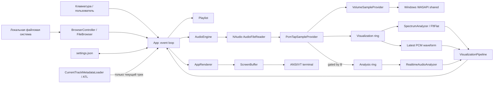
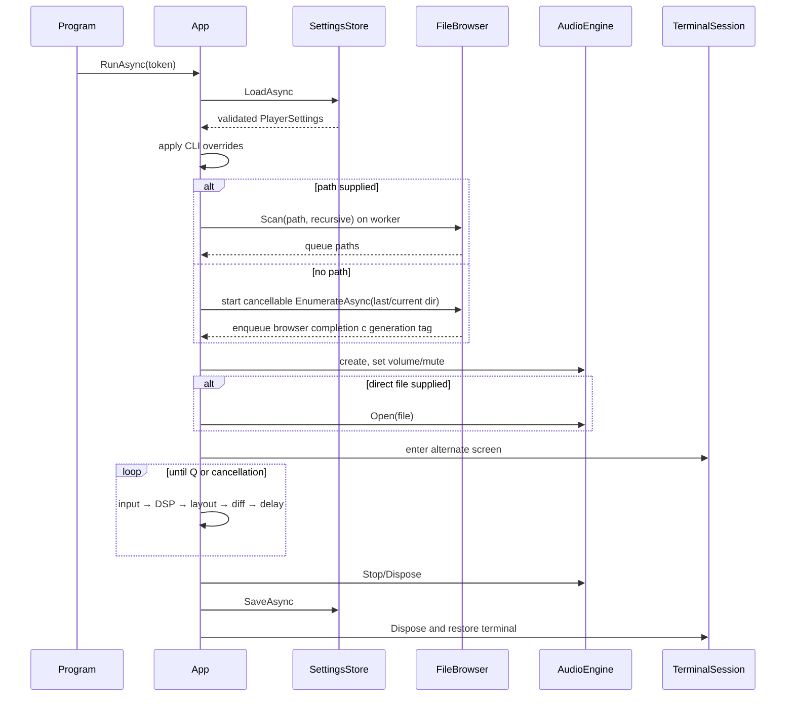
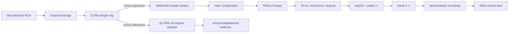

# Архитектура Yacplayer

**Язык:** Русский · [English](ARCHITECTURE.md) · [README](../README.ru.md)

## 1. Назначение документа

Документ описывает фактически реализованную архитектуру Yacplayer 1.26.5.11 на уровне компонентов, данных, потоков исполнения, состояний, resource ownership и build/release pipeline. Он не является списком желаемых функций: отличия текущей реализации от целевой модели перечислены в разделе «Ограничения и технический долг».

Целевая платформа приложения — Windows x64, `.NET 10`, `net10.0-windows`. Shipping unit — один managed executable с framework-dependent DLL-зависимостями и опциональным Inno Setup installer.

## 2. Архитектурные принципы

1. **Один процесс, один shipping project.** Нет сервисов, IPC, базы данных и plugin host.
2. **Audio path отделён от UI.** Декодирование и выдача PCM инициируются NAudio/WASAPI; FFT и ANSI-rendering не выполняются внутри audio callback.
3. **Bounded data flow.** PCM tap пишет в visualization ring и опциональный analysis ring фиксированного размера. При перегрузке старые samples вытесняются, а воспроизведение не ждёт DSP consumer.
4. **UI-состояние разделено между явными coordinators.** `App` владеет event loop и command routing; `BrowserController`, `CurrentTrackMetadataLoader`, `VisualizationPipeline` и `SettingsController` владеют своими mutable lifecycle, а `AppRenderer` — только layout.
5. **Доменная логика тестируема без устройства.** Playlist, ring buffer, FFT, settings, browser filtering и terminal diff не требуют WASAPI.
6. **Terminal output строится декларативно.** Каждый кадр сначала формируется в `ScreenBuffer`, затем сравнивается с предыдущим и превращается в минимизированный ANSI diff.
7. **Ошибки окружения не должны повреждать терминал.** `TerminalSession.Dispose` восстанавливает экран, цвета и курсор; Ctrl+C переводится в cancellation.

## 3. Контекст и зависимости



Runtime NuGet dependencies:

| Пакет | Версия | Роль |
|---|---:|---|
| `NAudio` | 3.3.0 | Meta-package и `AudioFileReader` |
| `NAudio.Core` | 3.3.0 | Wave/sample abstractions, readers/providers |
| `NAudio.Wasapi` | 3.3.0 | `WasapiPlayer`, Media Foundation integration |
| `FftFlat` | 1.0.1 | Complex FFT |
| `z440.atl.core` | 7.19.0 | Read-only metadata extraction |

Test-only dependencies: xUnit, Microsoft.NET.Test.Sdk, coverlet collector, xUnit VS runner.

## 4. Структура исходников

| Путь | Ответственность |
|---|---|
| `Program.cs` | Process entry point, UTF-8, CLI, exit codes, Ctrl+C, global startup error boundary |
| `App.cs` | Composition root, event loop, command routing и shutdown/settings orchestration |
| `Application/BrowserController.cs` | Browser navigation/load lifecycle, path deduplication и batch queue insertion |
| `Application/CurrentTrackMetadataLoader.cs` | Cancellation/completion ownership metadata текущего трека |
| `Application/VisualizationPipeline.cs` | Координация spectrum/waveform/realtime analysis и reset rules |
| `Application/SettingsController.cs` | Навигация полноэкранных настроек, изменение значений и проверка путей |
| `Presentation/AppRenderer.cs` | Player/browser/settings layouts, viewports и композиция `ScreenBuffer` |
| `Presentation/ReactiveThemeController.cs` | Сглаживание характеристик и вывод ограниченных HSL-цветов для музыкально-реактивного UI |
| `Cli/Arguments.cs` | Ручной детерминированный parser CLI и статический help text |
| `Configuration/` | Persisted settings и атомарное JSON-хранилище |
| `Library/Playlist.cs` | Queue navigation, selection, repeat, shuffle bag/history |
| `Library/FileBrowser.cs` | Enumeration, filtering, sorting, recursive scan |
| `Library/TrackEntry.cs` | Queue/media metadata model |
| `Library/MetadataService.cs` | Фоновый ATL loader текущего трека |
| `Audio/AudioEngine.cs` | Decoder/output lifecycle и playback commands |
| `Audio/PcmTapSampleProvider.cs` | PCM forwarding, mono visualization tap и gated analysis tap |
| `Audio/SampleRingBuffer.cs` | Bounded sample transport между audio и DSP |
| `Audio/PlaybackSnapshot.cs` | Immutable UI-facing playback snapshot |
| `Dsp/SpectrumAnalyzer.cs` | Hann, FFT, log bands, normalization |
| `Dsp/RealtimeAudioAnalyzer.cs` | Levels, zero-crossing, spectral features, beat pulse и эвристический tempo |
| `Terminal/TerminalSession.cs` | Alternate-screen RAII |
| `Terminal/ScreenBuffer.cs` | Styled cells, clipping/sanitization, ANSI diff batching |
| `tests/Yacplayer.Tests/` | Unit tests чистой логики |
| `installer/Yacplayer.iss` | Per-user x64 installer |

## 5. Запуск и завершение процесса

### 5.1 Entry point

`Program.cs` выполняет последовательность:

1. Переключает stdin/stdout в UTF-8.
2. Вызывает `Arguments.Parse(args)`.
3. Для malformed CLI печатает ошибку и возвращает `2`.
4. Для `--help`/`--version` печатает данные и возвращает `0`, не создавая `App`, аудио и alternate screen.
5. Проверяет существование переданного пути; отсутствие возвращает `3`.
6. Создаёт `CancellationTokenSource`; обработчик `Console.CancelKeyPress` отменяет token и подавляет немедленное завершение процесса.
7. Запускает `App.RunAsync`.
8. Неперехваченная startup/runtime exception печатается в stderr и возвращает `3`.

### 5.2 Application startup



### 5.3 Shutdown ownership

- `App.RunAsync` владеет `AudioEngine` и `TerminalSession` через `using`.
- `Q` сначала открывает модальный диалог `Yep` / `Nope`, где по умолчанию выбрано `Nope`; подтверждённый выход проходит через единый cleanup path.
- Ctrl+C отменяет delay/event loop; cleanup выполняется обычным control flow.
- Перед сохранением вызывается `audio.Stop()`.
- Ошибка сохранения `IOException` не мешает выходу.
- `TerminalSession.Dispose` посылает reset SGR, включает cursor и покидает alternate screen.

## 6. Application controller и event loop

`App` — composition root и coordinator event loop/команд. Отдельного DI-container нет. Он создаёт audio engine и четыре специализированных компонента:

- `BrowserController` владеет навигацией, cancellable generation-tagged loads, дедупликацией и queue batches;
- `CurrentTrackMetadataLoader` владеет cancellation/completion lifecycle текущего трека;
- `VisualizationPipeline` владеет обоими sample rings, smoothing spectrum, чтением waveform и reset realtime-анализа;
- `SettingsController` владеет выбором строки полноэкранных настроек и состоянием редактирования путей, возвращая эффекты изменений в `App`;
- `AppRenderer` владеет list viewports и всей композицией player/browser/settings layout, но не выполняет playback, filesystem или settings commands.

Главный цикл на каждом кадре:

1. Передаёт coordinators обработку generation-checked audio/browser/metadata completions в UI-owned state.
2. Пока `Console.KeyAvailable`, синхронно/асинхронно обрабатывает доступные клавиши.
3. Безопасно читает `Console.WindowWidth/Height`; исключение разрывает loop.
4. Получает `PlaybackSnapshot` из `AudioEngine`.
5. Просит `VisualizationPipeline` выполнить только активный visualizer и включённый realtime analysis и применить reset rules.
6. Упаковывает текущие references/snapshots в `AppRenderState`.
7. Просит `AppRenderer` создать `ScreenBuffer` и построить settings, browser либо player layout.
8. Вычисляет ANSI diff относительно прошлого кадра и пишет его в terminal.
9. Делает `Task.Delay(1000 / FPS, token)`.

Цикл не busy-spins. Фактический FPS является верхней границей: время обработки и rendering прибавляется к delay.

## 7. CLI

`Arguments.Parse` — single-pass parser без сторонней библиотеки. Он допускает один positional path и флаги в любом порядке.

Инварианты:

- `--fps` принимает только `30` или `60`;
- второй positional path — ошибка;
- неизвестный token, начинающийся с `-`, — ошибка;
- positional path нормализуется через `Path.GetFullPath`;
- parser не обращается к аудио или терминалу;
- existence check выполняется позднее в `Program`.

## 8. Playlist state machine

`Playlist` хранит:

- `_items: List<TrackEntry>`;
- `CurrentIndex: int?` — воспроизводимый элемент;
- `SelectedIndex` — выбранная UI-строка;
- `_bag: List<int>` — ещё не использованные shuffle indices;
- `_history: Stack<int>` — навигация назад;
- `Repeat` и `Shuffle`.

### 8.1 Последовательный режим

- `Next()` начинает с index `0`, если current отсутствует.
- В конце списка `RepeatMode.All` делает wrap на `0`.
- При `Off` следующий элемент в конце отсутствует.
- Автоматический EOF с `RepeatMode.One` повторно выбирает текущий index.
- Ручной next при `One` продолжает очередь, поскольку special case применяется только при `automatic=true`.

### 8.2 Shuffle

`RefillBag` заполняет bag всеми indices, кроме текущего. `PopBag` выбирает случайный элемент и удаляет его. Поэтому один index не повторяется до исчерпания bag. При активном shuffle `Add`/`AddRange` добавляют только indices новых элементов, не возвращая уже использованные элементы перестройкой цикла. При `All` начинается новый цикл; если playlist состоит из одного трека и заполненный bag остаётся пустым, current item воспроизводится напрямую без `PopBag`. При `Off` исчерпанный цикл завершает очередь.

### 8.3 Previous и removal

- Переключение track через `Play` помещает прошлый index в history.
- `Previous` сначала использует history, затем fallback на `index - 1`.
- После remove history очищается, bag перестраивается.
- Удаление current выбирает элемент на том же index, либо последний оставшийся.
- Удаляется только запись очереди; filesystem API удаления не вызывается.

### 8.4 Duplicate policy

Сам `Playlist` разрешает дубликаты. `App` поддерживает case-insensitive `HashSet` путей browser-очереди, поэтому повторный `Enter` и batch через `A` отбрасывают дубликаты в среднем за constant time на путь. Set синхронизируется при browser-add и удалении из queue.

## 9. Browser и filesystem

### 9.1 Enumeration

`FileBrowser.EnumerateAsync` выполняет отменяемое перечисление `FileSystemInfo` внутри `Task.Run`, использует уже полученные attributes вместо отдельного `Directory.Exists` для каждого элемента, оставляет каталоги и allowlisted extensions, затем сортирует каталоги первыми и имена case-insensitive.

Allowlist: `.wav`, `.mp3`, `.m4a`, `.aac`, `.wma`, `.flac`.

`IOException` и `UnauthorizedAccessException` преобразуются в пустой список. В текущей модели UI не различает пустой и недоступный каталог.

### 9.2 Navigation state

`BrowserController` хранит browser path, entries, selected index, queued-path deduplication и признак виртуального уровня дисков. Новая навигация отменяет предыдущую загрузку, очищает старые entries и немедленно возвращает управление frame loop. Worker публикует completion с generation tag; `App` просит controller применить его в UI-loop, где устаревшие generation игнорируются. Index `0` всегда зарезервирован:

- обычный каталог: `[..]`;
- виртуальный root: `[This PC]`.

`Backspace` и `Enter` на `[..]` вызывают одинаковый переход. Выше drive root строится список `DriveInfo.GetDrives().Where(IsReady)`.

`AppRenderer` владеет независимыми `ListViewport` для file list, основной queue и вспомогательной queue в browser. Каждый viewport удерживает target index видимым с запасом в одну строку, clamp-ит offset после изменения коллекции/высоты окна и не переставляет элементы исходной коллекции. Основная queue следует за `SelectedIndex` (playback также синхронизирует его с `CurrentIndex`), информационная queue в browser следует за `CurrentIndex`, когда он задан.

### 9.3 Recursive scan

`FileBrowser.Scan` использует явный `Stack<string>`. По умолчанию сканируется только текущий каталог. В recursive mode дочерние каталоги помещаются в stack, но directories с `FileAttributes.ReparsePoint` пропускаются, что защищает от типичных junction/symlink loops.

Ошибки отдельных каталогов поглощаются, после чего scan продолжает доступные ветви.

## 10. Audio subsystem

### 10.1 Объекты и ownership

`AudioEngine` владеет одним `AudioFileReader` и одним `WasapiPlayer`. Новый `Open` сначала вызывает `Close`, то есть одновременно активен максимум один decoder/output pair.

Создание output:

```csharp
new WasapiPlayerBuilder()
    .WithSharedMode()
    .WithLatency(100)
    .Build();
```

Source chain:

```text
AudioFileReader (ISampleProvider)
  → PcmTapSampleProvider
  → VolumeSampleProvider
  → ToWaveProvider()
  → WasapiPlayer.Init
  → default Windows render endpoint
```

### 10.2 Playback commands

- `Open(path)` — decoder, tap, output init и `Play`;
- `TogglePause()` — `Pause`/`Play` по состоянию output;
- `Stop()` — intentional stop, position `0`, ring reset;
- `Seek(seconds)` — clamp в `[0, TotalTime]`, затем ring reset;
- `SetVolume(0..100)` — изменяет расположенный после tap `VolumeSampleProvider`;
- `ToggleMute()` — сохраняет logical volume, устанавливает effective volume `0`;
- `Dispose()` — отписка event, stop/dispose output, dispose reader.

### 10.3 EOF и error events

`WasapiPlayer.PlaybackStopped` не изменяет playlist или UI. Он неблокирующе публикует bounded `AudioEvent` с generation активной пары decoder/output. Intentional stop/close подавляет EOF и инвалидирует generation. UI-loop читает очередь, игнорирует устаревшие generation, показывает ошибки и при естественном завершении вызывает `Playlist.Next(automatic: true)`, открывая следующий track либо выводя `Queue finished`.

### 10.4 Snapshot boundary

UI не получает decoder/output напрямую. `PlaybackSnapshot` содержит state, path, position, duration, sample rate, channels, logical volume и mute. Snapshot строится при каждом UI frame.

## 11. PCM tap и ring buffer

`PcmTapSampleProvider` реализует `ISampleProvider` и прозрачно возвращает decoder output вызывающей стороне. Mono data всегда копируется в visualization ring и только при включённом анализе — в отдельный analysis ring. `VolumeSampleProvider` расположен после tap, поэтому выходная громкость и mute влияют на WASAPI playback, но не меняют визуализацию или анализ.

- mono input копируется в ring блоком;
- multi-channel input downmix-ится средним арифметическим каналов на frame;
- tap не выполняет FFT, tempo estimation, logging, JSON, metadata или terminal I/O;
- `AudioEngine.SetRealtimeAnalysis(false)` прекращает запись во второй ring и меняет transport generation; `App` прекращает вызывать `RealtimeAudioAnalyzer` и скрывает панель;
- `AudioEngine.SetReactiveAnalysis(true)` дополнительно держит analysis ring наполненным (`PcmTapSampleProvider.AnalysisAlways`), даже когда realtime-панель выключена, потому что музыкально-реактивный UI потребляет те же характеристики; дорогой UI-side вызов анализатора по-прежнему гейтится потребностью панели или темы.

`RealtimeAudioAnalyzer` выполняется в UI-loop. Из ограниченных окон он получает RMS и peak dBFS, crest factor, zero-crossing rate, spectral centroid, dominant frequency и нормализованную характеристику энергии низких частот (40–150 Гц). Для анализа темпа используется Hann STFT на 1024 samples с hop 256 samples. Положительный прирост log-magnitude усредняется по низкому, среднему и высокому диапазонам и нормализуется относительно адаптивного baseline spectral flux, формируя onset envelope.

`BeatTracker` хранит ограниченную историю onsets. Normalized autocorrelation ищет 55–200 BPM, parabolic peak interpolation устраняет квантование по целому hop, а phase scoring штрафует гипотезы, предсказывающие неподтверждённые доли или объясняющие слишком малую часть onset energy. Одновременно сохраняется до восьми tempo/phase agents. Выраженные onsets корректируют каждый agent через proportional/integral PLL; evidence decay, confidence, continuity bias и switching hysteresis выбирают активный agent. Отображаемый beat строится из предсказанной phase, поэтому продолжается через короткие пропуски ударов, а не просто повторяет energy transient. Широкий prior предпочитает распространённые метрические уровни около 120 BPM, сохраняя кандидатов во всём диапазоне.

Результат остаётся causal realtime-оценкой, а не embedded BPM metadata или offline-анализом всего трека. Для захвата требуется несколько секунд; стабильность намеренно приоритетнее мгновенной реакции, а синкопированный, меняющийся или неоднозначный материал всё ещё может привести к выбору другого метрического уровня.

`SampleRingBuffer` имеет фиксированный `float[]` (округлённый вверх до степени двойки), monotonically increasing `_write`/`_read` counters и bitmask addressing. Producer владеет только `_write`; consumer владеет `_read` и при overflow сам подтягивает свою позицию до `write - capacity` перед копированием, поэтому самые старые samples теряются, а writer никогда не пишет курсор чтения.

`Reset` при stop/seek/track switch или смене режима приравнивает read position текущему write position, чтобы DSP не показал старый PCM. `ReadLatest` копирует новейший блок и отбрасывает backlog для waveform.

Модель конкурентности — один producer (audio callback, владеет `_write`) и один consumer (UI-loop, владеет `_read`). Catch-up при overflow выполняется полностью на стороне consumer, поэтому ни один курсор не пишется обеими сторонами; это заменило прежний протокол, где overflow producer тоже двигал `_read`, что при чередовании check-then-act могло откатить consumer. Конкурентные regression-тесты producer/consumer покрывают overflow, чередования `ReadLatest`/`Reset` и clamp устаревшей позиции.

## 12. DSP pipeline



`SpectrumAnalyzer` выделяет buffers и `FastFourierTransform` один раз в constructor. Для каждого анализа:

1. Пытается прочитать ровно FFT size samples через exact-window read.
2. При недостатке ничего не потребляет, сохраняет предыдущие output bands и возвращает `false`.
3. Умножает samples на заранее вычисленное Hann window.
4. Выполняет complex forward FFT.
5. Для каждой output band вычисляет логарифмические low/high frequencies.
6. Находит peak magnitude в соответствующих bins.
7. Применяет `log10(1 + peak) / 3` и clamp `0..1`.

UI использует 64 output bands и интерполирует их на фактическую ширину spectrum panel. Для вертикального уровня вычисляется непрерывный ANSI true-color градиент от зелёного через жёлтый к красному; над bar рисуется жёлтый peak marker. Это визуальный marker текущей высоты, не временной peak-hold buffer.

Режим Waveform читает до 4096 новейших mono PCM samples и применяет визуальное усиление кадра, поэтому форма видна при низкой громкости без изменения звука. Для каждой колонки вычисляется min/max envelope соответствующего диапазона samples, отображается относительно вертикального центра и рисуется зелёными `.`. Почти полная тишина остаётся пустой, чтобы не усиливать шум. В режиме Off не выполняется ни FFT, ни waveform sampling. Заголовок и информационная строка панели соответствуют выбранному режиму.

## 13. Terminal subsystem

### 13.1 TerminalSession

В interactive mode constructor отправляет:

- `CSI ?1049h` — alternate screen;
- `CSI ?7l` — отключить automatic line wrapping;
- `CSI ?25l` — hide cursor;
- `CSI 2J` — clear.

Dispose отправляет SGR reset, восстанавливает automatic line wrapping, показывает cursor и покидает alternate screen. При redirected stdout session ничего не пишет.

### 13.2 Cell model

Одна `Cell` содержит:

- UTF-16 `char`;
- ANSI foreground color;
- ANSI background color;
- bold flag.

`ScreenBuffer.Write` clip-ит координаты по границам и заменяет ESC/control characters пробелом. Это не позволяет metadata/path text внедрять raw ANSI sequences через текущий char writer.

Ограничение: layout по-прежнему считает один `char` одной terminal column. Grapheme clusters, surrogate pairs и East Asian wide characters отдельно не измеряются; строки с вероятными wide/zero-width Unicode символами помечаются для консервативной перерисовки.

### 13.3 Diff algorithm

`Diff(previous)` пропускает равные cells. Изменённые соседние cells с одинаковым style объединяются в horizontal run:

1. Один cursor-position escape на run.
2. SGR отправляется только при смене fg/bg/bold.
3. Затем подряд пишутся characters run.
4. В конце цветового frame при необходимости отправляется SGR reset.

При resize размеры buffers отличаются, поэтому следующий кадр полностью перерисовывается.

Если текущая или предыдущая версия строки содержит Unicode потенциально переменной ширины, diff сначала очищает эту terminal row и затем полностью её перерисовывает. Остальные строки сохраняют обычный точечный diff.

### 13.4 Responsive layout

Player layout:

- всегда: header и footer;
- при `width >= 90 && height >= 22`: Now Playing, Queue, Spectrum, Playback, Audio Info;
- иначе: компактные Now Playing и Spectrum.

Browser layout:

- при width ≥ 70: files слева, queue справа;
- при меньшей ширине: одна files panel.

### Музыкально-реактивная тема UI

`ReactiveThemeController` (только UI-loop) преобразует сглаженные музыкальные характеристики в ограниченную цветовую схему для рамок панелей, фонов зелёных заголовков панелей, фона активной строки очереди, футера, столбцов спектра (реактивный градиент сохраняет форму зелёно-тёплого перехода, повёрнутую к оттенку темы и осветлённую пульсом баса; верхний маркер столбца следует теме вместо статического жёлтого), заполнения прогресс-бара и точек waveform. Энергия баса управляет пульсацией яркости (single-pole attack ≈ 50 мс, release 280–380 мс, амплитуда примерно 18–28% светлоты в зависимости от режима), spectral centroid логарифмически отображается в ограниченный диапазон оттенка от жёлто-зелёного до циана (не полный цветовой круг) с постоянной времени 1.6–2.2 с, а RMS модулирует насыщенность вокруг статического зелёного. Обновления гейтятся примерно 12.5 FPS независимо от частоты UI/FFT. Когда `ReactiveUiMode` = `Off` (значение по умолчанию), контроллер ничего не выполняет, и рендерер сохраняет статическую ANSI-тему; когда воспроизведение не активно или характеристики недоступны, параметры плавно возвращаются к базовой теме через путь release, а не переключаются скачком. Цвета выводятся как RGB true-color SGR-последовательности (спектр уже требует true color); терминалы без true-color видят те же последовательности и могут понижать их — это соответствует существующему поведению спектра. Геометрия, layout, информационный текст и семантически значимые цвета не меняются.

## 14. Input routing

Input имеет контекстный приоритет:

1. Диалог подтверждения выхода принимает стрелки/Tab, Enter, Esc, Y и N. Он доступен поверх player, browser, help и settings, кроме режима редактирования пути настройки.
2. Если открыт help overlay, принимаются только close keys.
3. Если открыт browser, клавиши маршрутизируются в browser commands; например `Enter` не запускает selected queue item.
4. Иначе действует player keymap.

`Console.KeyAvailable` предотвращает блокировку frame rendering. Ввод не передаётся в shell и не интерпретируется как ANSI text.

## 15. Settings

`PlayerSettings` — сериализуемая mutable model с version `1`.

Validation:

- volume clamp `0..100`;
- FPS только `30` или `60`, иначе `30`;
- FFT size только `2048` или `4096`, иначе `2048`;
- неизвестные enums заменяются defaults;
- отсутствующие `LastDirectory` и `StartupDirectory` очищаются.

`SettingsStore.LoadAsync`:

- отсутствие файла → defaults;
- valid JSON → deserialize + validate;
- `JsonException` → попытка move в `.bad` + defaults;
- `IOException` → defaults.

`SaveAsync` создаёт directory, пишет `.tmp`, затем `File.Move(tmp, target, overwrite: true)`.

CLI FPS, recursive и no-visualizer меняют in-memory settings текущего запуска. Загруженные `RepeatMode`/`Shuffle` применяются к `Playlist` при startup. `RealtimeAnalysisEnabled` хранит состояние клавиши `B` и по умолчанию равен true. Без CLI-пути startup последовательно выбирает `StartupDirectory`, `LastDirectory` и process working directory.

`O` открывает полноэкранные настройки. Каждое корректное изменение применяется в UI-loop и сразу передаётся в `SettingsStore.SaveAsync`; volume/mute, FPS, FFT size, visualizer, realtime analysis, repeat, shuffle и recursive scan влияют на текущий процесс. Изменение `LastDirectory` запускает асинхронную загрузку browser, а `StartupDirectory` задаёт следующий запуск без пути. Версия схемы показывается read-only. На shutdown по-прежнему фиксируются и сохраняются runtime volume, mute, repeat и shuffle.

## 16. Metadata

`TrackEntry` содержит path, title, artist, album, duration и metadata state. Defaults берутся из имени файла/`Unknown artist`.

`MetadataService.LoadAsync` создаёт `ATL.Track` на worker task и возвращает Title/Artist/Album/Duration с fallback-значениями. Исходный файл не изменяется.

`App` запускает чтение только для текущего элемента playlist. При смене трека предыдущий запрос отменяется, а устаревший результат игнорируется. Worker не изменяет `TrackEntry`: он кладёт результат в concurrent queue, после чего UI-цикл применяет его и устанавливает `MetadataState` в `Loaded` или `Failed`. Не запускавшиеся треки сохраняют значения из имени файла/`Unknown artist`.

## 17. Error handling

| Boundary | Поведение |
|---|---|
| CLI parse | stderr + exit 2 |
| Missing startup path | stderr + exit 3 |
| Decoder/output open | bounded `AudioEventKind.Error`, status message в UI, process продолжает работу |
| Playback exception | bounded `AudioEventKind.Error` с generation tag |
| Browser IO/access | empty list, UI остаётся активным |
| Recursive scan branch error | branch skip |
| Bad settings JSON | rename `.bad`, defaults |
| Settings IO | defaults/load или ignored save error |
| Terminal size exception | event loop завершается и session восстанавливается |
| Ctrl+C | cancellation → normal cleanup |
| Other top-level exception | stderr + exit 3 |

## 18. Threading model

Потоки/contexts:

- main async thread: input, playlist state, browser state, DSP, layout, settings orchestration;
- NAudio playback thread: calls provider `Read`, выполняет downmix, постоянную запись visualization ring и условную запись analysis ring;
- thread pool: directory enumeration/scan и isolated metadata load;
- NAudio event context: `PlaybackStopped` только пытается записать событие в bounded channel.

Нет unbounded thread creation. Явные межконтекстные границы — ring, bounded audio-event channel и browser/metadata completion queues. Playlist/browser/audio transitions выполняются UI-loop; workers публикуют generation-checked результаты, а NAudio callback никогда не ждёт consumer.

## 19. Performance characteristics

- PCM ring capacity: `32768` mono samples.
- Realtime-analysis ring: `65536` mono samples; его запись и consumer DSP отключаются клавишей `B`.
- WASAPI requested latency: `100 ms`.
- UI FPS: `30` default, `60` optional.
- FFT: `2048` default, `4096` accepted from settings.
- FFT buffers и Hann window переиспользуются.
- ScreenBuffer создаётся на каждый кадр; это UI-side allocation и не влияет на audio callback.
- Diff renderer уменьшает terminal traffic, объединяя styled runs.
- При DSP lag ring отбрасывает старые samples.
- Browser directory enumeration выполняется вне UI loop и не блокирует кадры; direct startup scan и scan по `A` всё ещё материализуют полный результат.

Проект не заявляет конкретные CPU/RAM показатели без профилирования. Рекомендуемые инструменты: `dotnet-counters`, `dotnet-trace`, Windows Performance Recorder.

## 20. Tests

Тесты не создают реальный WASAPI device.

Покрыто:

- CLI invalid flags/FPS/help и четырёхкомпонентная assembly release version;
- empty/basic playlist, repeat, remove;
- shuffle cycle uniqueness;
- ring wrap/overwrite/count;
- identical screen diff, one-cell change, color-only change, ANSI run batching;
- settings validate/roundtrip/bad JSON;
- silence и 1 kHz synthetic FFT signal;
- gated pre-volume analysis tap и synthetic level/frequency/tempo signal;
- metadata fallback/nonfatal behavior;
- browser directory-first sorting и extension filtering.

Не покрыто автоматически:

- реальное WAV/MP3 playback и hardware output;
- pause/seek/mute timing на WASAPI;
- natural EOF race и rapid track switching;
- interactive input routing и layout snapshots разных размеров;
- installer execution/uninstall;
- long-running soak/memory profiling;
- concurrent ring stress после последних изменений.

## 21. Build, publish и installer

Build graph:

```text
Yacplayer.sln
├─ src/Yacplayer/Yacplayer.csproj       net10.0-windows executable
└─ tests/Yacplayer.Tests/...csproj      xUnit, references app project
```

`ApplicationIcon` ссылается на `assets/Yacplayer.ico`, содержащий PNG-backed sizes 16, 24, 32, 48, 64, 128 и 256 px.

Publish framework-dependent:

```powershell
dotnet publish src/Yacplayer/Yacplayer.csproj -c Release -r win-x64 --self-contained false -o artifacts/publish
```

Native AOT publish:

```powershell
dotnet publish src/Yacplayer/Yacplayer.csproj -p:PublishProfile=NativeAotWinX64
```

Профиль `NativeAotWinX64` создаёт trimmed self-contained нативный исполняемый файл в `artifacts/publish-aot`. JSON-настройки используют source-generated metadata `System.Text.Json`, поэтому persistence не требует генерации кода во время выполнения. Профиль меняет способ развёртывания и характеристики запуска, но не устраняет привязку к Windows/WASAPI.

Inno Setup:

- per-user install в `{localappdata}\Programs\Yacplayer`;
- x64-compatible only;
- Windows minimum `10.0.17763`;
- English/Russian wizard;
- Start menu и optional desktop shortcut;
- working directory shortcut — `{userdocs}`, чтобы first browser launch не открывался в install directory;
- проверка folder pattern `.NETCore.App\10.*`;
- bundled README, LICENSE и third-party notices;
- PDB исключён;
- output `artifacts/installer/Yacplayer-1.26.5.11-win-x64-setup.exe`.

## 22. Security и privacy

- Телеметрия и сетевые запросы в runtime отсутствуют.
- Программа читает только выбранные локальные media files/settings и не изменяет media.
- Browser Delete не привязан к filesystem deletion.
- Control characters в terminal cells заменяются пробелами.
- Reparse points не обходятся recursive scanner.
- External codec executables не запускаются.
- Installer открывает официальный .NET download URL только после явного согласия, если runtime не найден.
- Проект не является security sandbox: malformed media обрабатывается сторонними decoder/metadata libraries в процессе приложения.

## 23. Ограничения и технический долг

Приоритетные разрывы текущей архитектуры:

1. Отличать inaccessible directory от legitimately empty directory.
2. Добавить grapheme/display-width aware text layout.
3. Перевести ring implementation на чётко доказанный SPSC algorithm и добавить длительный concurrent stress test.
4. Добавить integration WAV fixture, manual/optional WASAPI smoke test и terminal snapshot tests.
5. Рассмотреть self-contained installer или автоматический bootstrap runtime вместо блокирующей prerequisite check.
6. Переиспользовать два screen buffer и pooled ANSI output, чтобы уменьшить per-frame GC pressure.
7. Добавить time-based decay спектра и пропускать spectrum analysis при inactive playback.
8. Пакетно выполнять multichannel downmix/ring writes и сделать recursive scans incremental/cancellable.

## 24. Точки расширения

### Новый decoder/format

Расширение в browser allowlist само по себе не добавляет decoder. Нужно подтвердить, что `AudioFileReader`/Media Foundation реально открывает формат, обновить format matrix, error messages и integration tests.

### Новый visualization mode

Нужны отдельные DSP snapshot/model и renderer path. Нельзя выполнять анализ в `PcmTapSampleProvider.Read`; worker/UI consumer должен читать bounded data.

### Новый terminal widget

Widget должен писать только через `ScreenBuffer`, соблюдать clipping и не вставлять raw escape sequences. ANSI policy остаётся внутри `ScreenBuffer.Diff`/`TerminalSession`.

### Новая persisted setting

Добавить property с default, validation/migration logic, документировать JSON и обеспечить backward compatibility `Version`.

### Новый background operation

Operation должен иметь cancellation, bounded concurrency и наблюдаемую ошибку. Результат должен применяться к UI-owned state через event/command boundary.

## 25. Архитектурные инварианты

- Одновременно существует не более одного active audio reader/output pair.
- Audio callback не выполняет FFT, terminal rendering, metadata или JSON I/O.
- Ring buffer имеет ограниченную память и никогда не ждёт consumer.
- Queue removal не удаляет physical file.
- Help/version не создают audio/TUI.
- Raw пользовательский текст не становится ANSI escape sequence.
- Terminal restoration выполняется через deterministic disposal.
- Recursive scan не следует directory reparse points.
- Runtime не использует сеть и внешние decoder executables.
